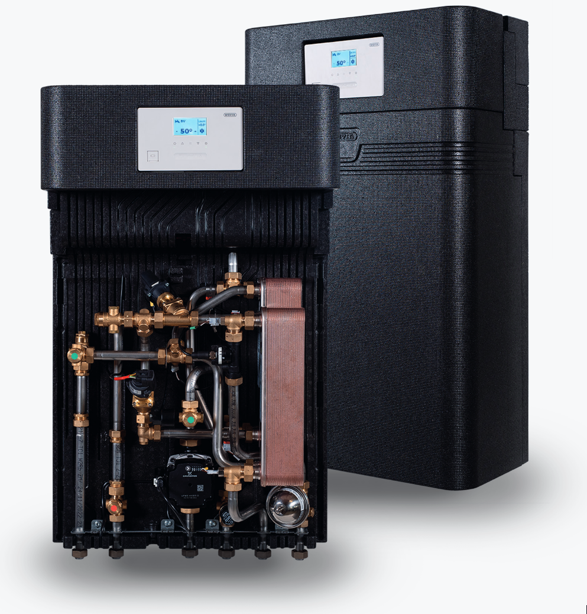
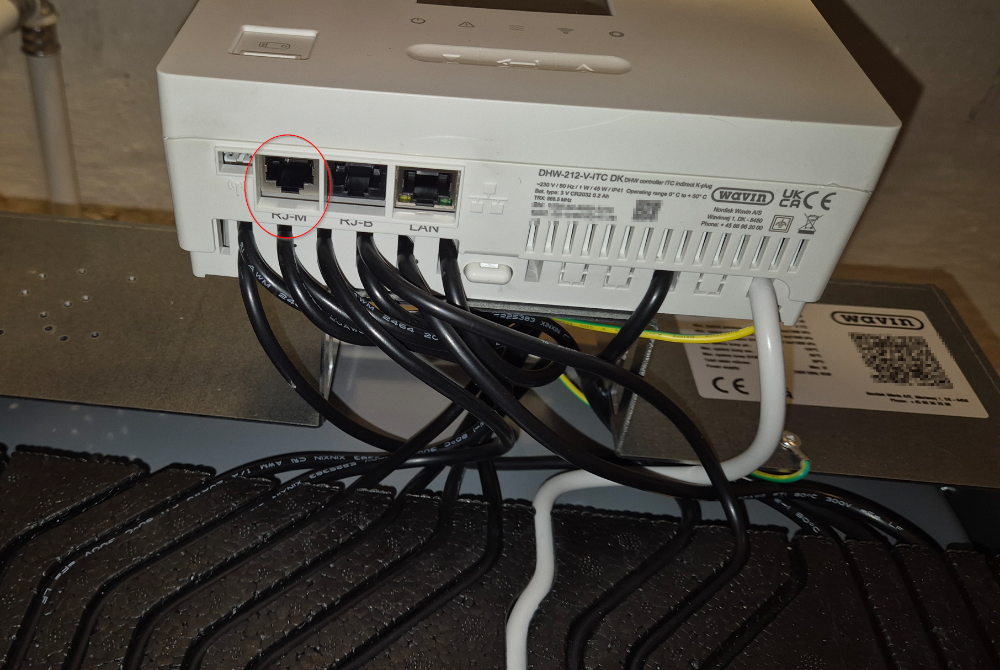
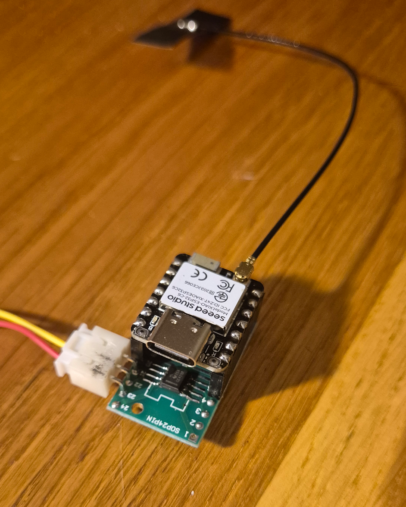
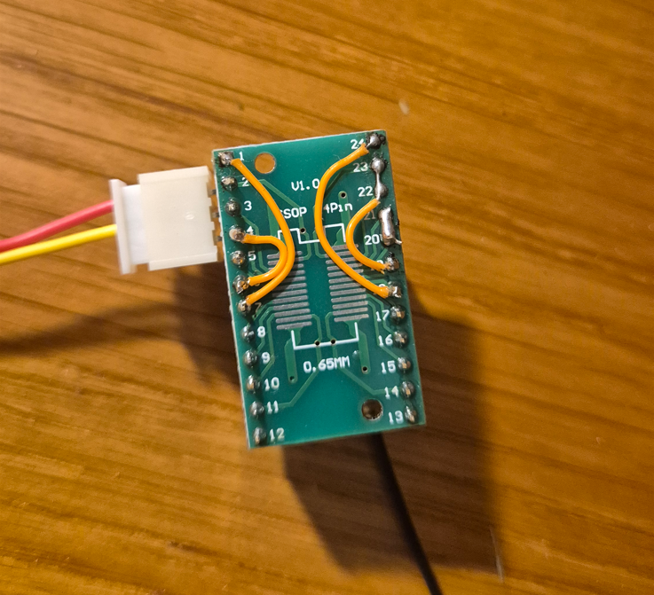
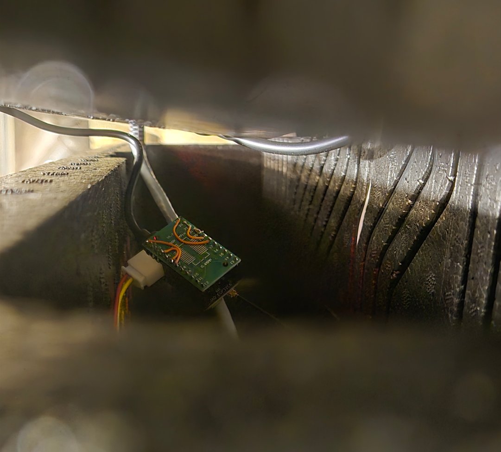
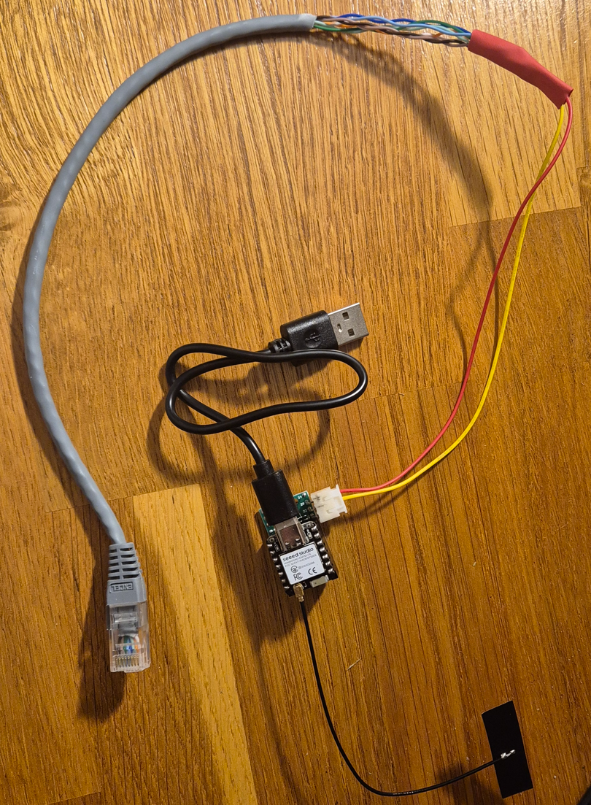
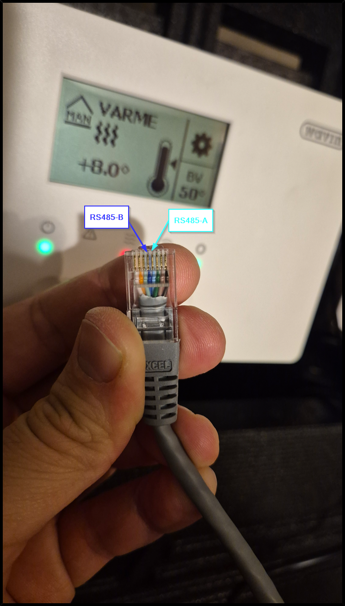

# Wavin Calefa II – Modbus RTU data logger

Read data from a **Wavin Calefa II** district-heating apartment station
(DHW 212 V ITC display/controller) over its RS-485 Modbus RTU port, and
document its register map. The unit is integrated into Home Assistant through
an ESP32 gateway (Seeed XIAO ESP32-C6) running ESPHome (`esphome/calefa_modbus.yaml`).



## Hardware

* Calefa II controller board, **RJ-M** port (Modbus slave). Do not use RJ-B,
  which is the internal 57600 bps bus.
* USB/RS-485 adapter (FTDI RS485 WE), here on `/dev/ttyUSB1`.

On the RJ-M port, **pins 4 and 5 carry the RS-485 pair**. The other pins
have not been identified. No 24 V was measured on RJ-M (only on RJ-B).

Serial settings: **9600 bps, 8N1, slave address 1**.



## ESP Modbus Module

* Calefa II controller board, **RJ-M** port (Modbus slave). Do not use RJ-B,
  which is the internal 57600 bps bus.
* Seeed Xiao ESP32C6 or similar, ESP32 super mini...
* SOIC 20 breakout PCB
* RS485 transceiver IC 3.3V 
* USB AC to DC 5V power brick







In esphome, load the `esphome/calefa_modbus.yaml` configuration to start polling data from the heating unit.
The available USB port of the DHW-212-V-ITC is not powerful enough to power the ESP32, you'll need an external USB brick.

Configure 9600 8bits no parity 1 stop bit in the Calefa 2 menu.

## Setup

```bash
python3 -m venv .venv
.venv/bin/pip install pyserial
```

The user must be in the `dialout` group to open the serial port.

## Files

| File | Purpose |
|---|---|
| `modbus_rtu.py` | Minimal Modbus RTU master (pyserial only): FC01/02/03/04/06, exception handling |
| `scan.py` | Finds every valid address in all four tables (0–65535) → `scan_result.json` |
| `wavin_calefa.py` | Poller: reads all valid registers and decodes them by name |
| `REGISTER_MAP.md` | **Register map** worked out so far (confirmed vs. guessed) |
| `esphome/calefa_modbus.yaml` | ESPHome config (XIAO ESP32-C6: TX GPIO0, RX GPIO2, DE/RE GPIO1) exposing sensors, alarms and setpoints to Home Assistant |
| `homeassistant/` | Dashboard synoptic: `calefa_synoptic.svg` (copy to `/config/www/`), `calefa_card.yaml` (picture-elements + history graphs); both generated by `gen_synoptic.py homeassistant` |
| `docs/` | Wavin Sentio Modbus manual and the earlier technical report |
| `scan_result.json`, `scan_log.txt` | Raw output of the full address scan |
| `watch_*.csv / *.txt` | Recordings used to identify registers (heating switch-off, hot water draw, parameter edits) |

## Usage

```bash
.venv/bin/python wavin_calefa.py                 # decoded table
.venv/bin/python wavin_calefa.py --json          # decoded values as JSON
.venv/bin/python wavin_calefa.py --raw           # every valid register, raw
.venv/bin/python wavin_calefa.py --watch 2 --csv log.csv   # print changes, log to CSV
.venv/bin/python scan.py --tables holding,input  # re-scan the address space (~7 min per table)
```

A full poll (~1200 values) takes about 4.5 s at 9600 bps.

## Key findings

* Addresses are raw 0-based PDU addresses. The Sentio document's numbers map
  1:1, with no −1 offset.
* Any read that touches an invalid address fails as a whole (exception 2), so
  reads must stay inside the valid ranges listed in `REGISTER_MAP.md`.
* Temperatures are signed int16 × 0.01 °C; `32767` means not available.
* Sensors:
  * T1 heating exchanger primary return, district side (IR 7702)
  * T2 heating flow (IR 7701)
  * T3 cold water (IR 6509)
  * T4 hot water outlet (IR 6505)
  * T5 district-heating supply (IR 6506)
  * T6 hot water exchanger primary return, district side (IR 6507)
* Hot water flow: IR 6510 in l/h. Hot water state: IR 6502 (1 = tap open, 2 = idle).
* Outdoor temperature: IR 20 (actual), 21 (filtered), 22 (averaged).
* Writable settings include:
  * hot water setpoint (HR 6521)
  * room setpoint and presets (HR 7501–7504)
  * heat curve slope, minimum and maximum (HR 7701, 7706, 7707)
  * PI regulator (HR 7708, 7709)
  * return limiter (HR 7716–7718)
* The heating hysteresis and offset are **not** exposed over Modbus.

## Next steps

* Identify the remaining unknown registers (see "Still open" in `REGISTER_MAP.md`).
* ~~Write test via Modbus (FC06)~~ – done: hot water setpoint, room setpoint and heat offset all write correctly.
* ~~ESP32 gateway~~ – done: Seeed XIAO ESP32-C6 + RS-485 transceiver running ESPHome, config in `esphome/calefa_modbus.yaml`.
